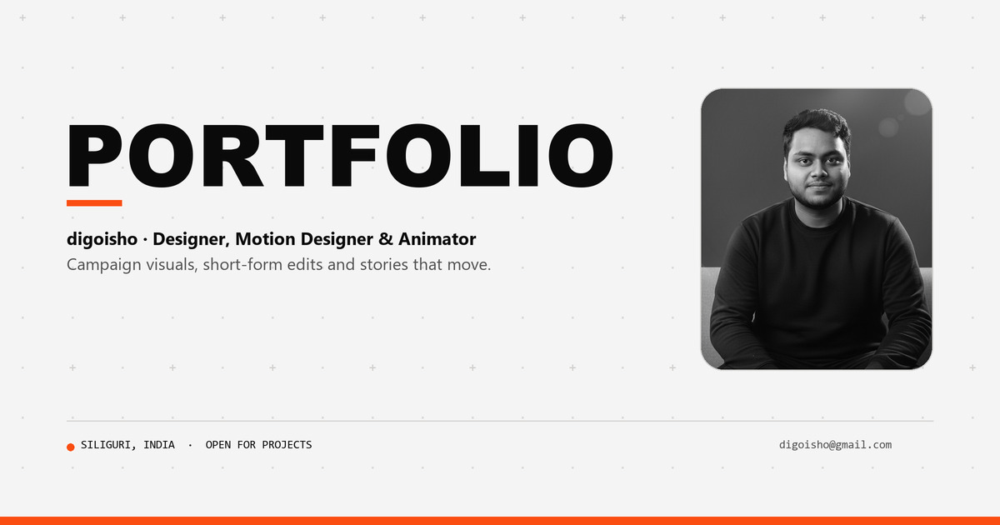

# digoisho - Portfolio (`2026_03`)



Personal studio portfolio of **digoisho** - Design Head, Motion Designer, 2D Animator, and Video Editor based in Siliguri, India.

Built as a zero-dependency, single-document interactive stage (`index.html`) anchored around a strict **70 / 20 / 10** editorial color system (`#F5F4F4` Studio Off-White · `#0A0A0A` Jet Carbon · `#FA4D11` Blaze Vermilion) with zero neon glow washes, custom isotropic folder-tab geometry, spring-driven pebble mascots, a locked `30 fps` motion sequence showcase, an interactive folder-pocket gallery, and a scroll-reactive dark-mode envelope footer.

---

## Latest Project Update

### 1. Interactive Pebble Mascots (Hero & Pre-Footer)
- **Hero Mascot (`#hero`)**: Tracks the pointer with spring-damped head, visor, and eye parallax (falling back to a smooth autonomous keyframe loop when idle). Remains neutral on hover and only smirks + pops a `hello.` thought bubble for **1.5 seconds** when clicked.
- **Pre-Footer Mascot (`shooter`)**:
  - Runs a staged `;` thought-bubble sequence once scrolled into view (`Standard Galactic Alphabet` → `0.5s` rolling digit counter → `hello.` → `do you play video games?`).
  - Clicking triggers `pew pew!`, recoils the head, and fires `#FA4D11` projectiles toward the cursor when aimed from a distance, or randomly within **±20°** of left (`180°`) or right (`0°`) when clicked up close.
  - Guarded synthetic `click` handling (`e.detail === 0`) so mouse/touch presses never double-fire.

### 2. Locked `30.00 fps` Motion Showcase & Asset Compression
- **Exact `30.00 fps` Playback (`#motion-showcase`)**: Uses a VSync-snapped `33.33ms` frame accumulator paired with an off-thread sliding `ImageBitmap` lookahead decoder (`createImageBitmap` + `IntersectionObserver` viewport gating) for judder-free playback.
- **92.3% Sequence Size Reduction**: Generated full-HD `1920×1080` `.webp` frames in `Images/Motion Video BG WebP/` (**`59.6 MB`** total down from **`769.9 MB`** raw PNGs), with frame `00001.webp` preloaded and automatic fallback to `.png`.

### 3. Work Section (`#work`) Performance, Carousel Direction & Alignment
- **Lightweight Card Previews & Pre-Blurred Ambients**:
  - Generated `58` `.webp` card previews in `Works/_preview/` (**`3.29 MB`** total vs **`28.02 MB`** originals) and `58` pre-blurred, darkened `.webp` ambient backdrops in `Works/_ambient/` (**`14.5 KB`** total).
  - Removed live per-card `filter: blur(24px)` rasterization, restricted `will-change: transform` to active visible cards, added idle off-thread `.decode()` warm-up, and preserved full-resolution originals inside the zoom Lightbox (`#lbox`).
- **Reversed Pocket Carousel Direction**: Upcoming cards (`02`, `03`, …) now stage on the **right** behind Next (`>`), while viewed cards move to the **left** behind Previous (`<`).
- **Balanced Stage Geometry**: Equalized the top gap above the `WORK` header and the bottom gap below the `< 01 >` carousel controls while keeping the stage centered horizontally in the content column.

### 4. Special Mentions & Section Spacing Polish
- **Glitch-Free Special Mentions Overlay (`#sm-overlay`)**: Replaced simultaneous `backdrop-filter: blur()` + full-screen `clip-path` circle rasterization with GPU-composited `opacity` + `transform` transitions, switched to eager-decoded `Images/elma.webp` and `Images/elma-ava.webp`, and paused background canvas loops while modals are open.
- **Typography & Floating Pill Updates**:
  - Fixed link contrast in `.sm-links .soc-link` (`#0A0A0A` text, `#FA4D11` hover) on the light `#F5F4F4` stage.
  - Streamlined `#sm-bubble` to display a single `SPECIAL MENTIONS` label (`CLOSE ×` when open) and added right-side clearance on `.folder-strip` and `.foot-bar` so the pill never overlaps links.
- **Hero & Pre-Footer Spacing**:
  - Removed the eyebrow badge above `PORTFOLIO` in `#hero`.
  - Added dynamic panel height syncing (`syncAboutHeight()`) across `Profile`, `Experience`, and `Toolkit` in `#about`, plus SVG bounds compensation on `.prefoot-mascot-wrap` so top and bottom visual gaps around the pre-footer mascot stay equal across all tabs.

### 5. Idle CPU Optimization, Social Cards & Accessibility
- **Portrait Compression**: Converted `Images/digoisho.png` (`699.3 KB`) to alpha-preserving `Images/digoisho.webp` (**`21.7 KB`**, 96.9% smaller).
- **Envelope Footer Idle Sleep (`#contact`)**: Added `IntersectionObserver` gating, cached resize measurements, and settle detection so the scroll-driven envelope uses `0%` CPU when offscreen or at rest.
- **Social Share Preview (`Open Graph` & `Twitter`)**: Added `Images/og-cover.jpg` (`1200×630`) and complete `og:*` / `twitter:*` metadata in `<head>`.
- **Keyboard & Screen-Reader Polish**: Added `Tab` / `Shift+Tab` focus trapping and focus restoration on `#sm-overlay` and `#lbox`, plus WAI-ARIA `aria-controls` / `aria-labelledby` wiring and Left/Right arrow-key switching on the `#about` folder tabs.

---

## Project Structure

```text
├── index.html                      # Main portfolio application (styles, SVG defs, markup & runtime)
├── mascot-preview.html             # Standalone interactive mascot rig sandbox
├── Images/
│   ├── Digoisho logo.svg           # Brand mark & favicon
│   ├── digoisho.webp               # Optimized studio portrait (alpha WebP)
│   ├── elma.webp / elma-ava.webp   # Optimized Special Mentions portrait & pill avatar
│   ├── og-cover.jpg                # 1200×630 Open Graph / social share preview card
│   ├── Motion Video BG WebP/       # 1920×1080 @ 30fps WebP sequence frames
│   └── Motion Video BG/            # Source 1920×1080 PNG sequence frames (fallback)
└── Works/
    ├── 2D Artworks/                # Full-resolution digital paintings (Lightbox)
    ├── Campaign Creatives/         # Full-resolution brand & social campaign posts (Lightbox)
    ├── _preview/                   # Lightweight WebP gallery card previews
    └── _ambient/                   # Pre-blurred WebP card backdrop fills
```

---

## Running Locally

No build tools or package installs are required. Serve the root folder over any static HTTP server (or open `index.html` directly):

```bash
npx serve .
# or
python -m http.server 8080
```

---

## Contact

- **Email**: [digoisho@gmail.com](mailto:digoisho@gmail.com)
- **Instagram**: [@digoisho](https://www.instagram.com/digoisho)
- **LinkedIn**: [/in/digoisho](https://www.linkedin.com/in/digoisho/)
- **Behance**: [/dg138](https://www.behance.net/dg138)
